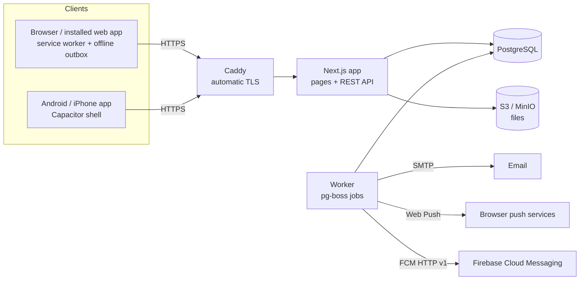

# Flight Ops

A flight operations management system for a military helicopter unit: it runs a sortie from aircraft serviceability to debrief, enforces every approval gate, and works on phones in the field even with no signal.

It runs as a website, installs on Android (with phone notifications), and ships with a native store-app shell for Google Play and the App Store.

> This public copy uses a fictional unit ("Demo Helicopter Squadron") and a generic logo. Each unit that adopts the system sets its own name, home aerodrome, logo and watermark in **Settings**.

## What it does

| Area | What happens |
| --- | --- |
| Serviceability | Engineering confirms each aircraft's status and hours to inspection (HH:MM) for each flying day. Unconfirmed aircraft cannot be published. |
| Scheduling and mission orders | Every sortie is scheduled together with its mission order: category (Training / Operational), type, crew, times and the order's task and objectives. |
| Order approval | The flying-wing commander or the unit commander approves the order. Only the Operations Officer can then publish it. Material changes send it back for approval. |
| Crew pairing | Trainee pilots must fly with an instructor; co-pilots with an instructor or captain. Crew and aircraft overlaps are refused. |
| Readiness clock | A background worker asks the crew for readiness at T-60, flags non-replies at T-45 and reminds the pilot in command at T-30. |
| Risk assessment | Eight categories rated 1–5 plus an IMSAFE check per crew member. The weather rating is pre-filled from the latest METAR against ICAO minima. |
| Risk approval | Command approves, approves with remarks or rejects; comments sit alongside. A sortie is Cleared only when every gate is met. |
| Weather | METAR and TAF entered by form (the code is composed for you) or pasted, and shown in plain English. |
| Flight plans and close-out | Crews file plans; Ops approves. After landing the pilot in command records outcome, flight time, fuel (kg / L) and snags, which update aircraft hours. |
| Reports | Daily, weekly, monthly and quarterly summaries, generated automatically, exported as PDF and Excel by authorised roles. |
| Notifications | Every item goes to the phone (Web Push / Firebase); only items needing action also go by email, which never carries operational detail. |
| Offline | Flight-line forms are kept in an on-device outbox and sent when the connection returns. |
| Security | Admin activation, two-step sign-in (TOTP) for command and admin roles once a day per device, idle sign-out, role-based permissions and an append-only audit log. |

## Roles

| Role | Main responsibilities in the app |
| --- | --- |
| Commander | Approve mission orders and risk assessments, appoint an acting commander, export reports |
| Second in command (GOO) | Pilot functions; all Commander functions while appointed acting Commander |
| CO Flying Wing | Approve mission orders and risk assessments, export reports |
| CO Engineering | Daily serviceability, aircraft records, close snags |
| Operations Officer | Schedule and publish sorties, enter weather, approve flight plans, export reports |
| Training Officer | Schedule training sorties |
| Safety Officer | Oversee risk (comment only), manage hazard and incident reports, export the safety extract |
| Pilots | Readiness, IMSAFE, risk submission, flight plans, close-out, snags |
| Admin | Accounts, change requests, settings, aircraft register, audit log |

Permissions come from a person's appointment, plus pilot functions for anyone with a flight status (`src/lib/rbac.ts`).

## How it is built



- **Web:** Next.js 15 (App Router), React 19, TypeScript, Tailwind CSS
- **Data:** PostgreSQL 16 with Prisma, S3-compatible storage (MinIO) for attachments
- **Jobs:** pg-boss worker for the mission clock, emails, push, inspection warnings and summaries
- **Auth:** argon2 password hashing, short-lived JWT access tokens with rotating refresh sessions, TOTP two-step sign-in
- **Exports:** PDFKit and ExcelJS
- **Mobile:** installable PWA with Web Push; Capacitor 8 shell with Firebase Cloud Messaging for the stores (`mobile/`)
- **Deploy:** Docker Compose with Caddy for HTTPS

| Path | Contents |
| --- | --- |
| `prisma/schema.prisma` | Database schema |
| `src/app/(auth)`, `src/app/(app)` | Sign-in and the signed-in screens |
| `src/app/api/v1` | REST API |
| `src/lib/rules` | Crew pairing and risk scoring (pure, unit-tested) |
| `src/lib/services` | Missions, orders, risk, aircraft, flight plans, close-out |
| `src/lib/weather` | METAR / TAF parser, composer and plain-English reader |
| `src/worker` | Background jobs |
| `public/sw.js` | Service worker (offline pages, push) |
| `mobile/` | Play Store / App Store shell |
| `tests/` | Rule tests |

## Run it locally

Requirements: Node.js 20.11+, Docker.

```bash
cp .env.example .env          # set DATABASE_URL host to localhost:5433, S3_ENDPOINT to http://localhost:9000
docker compose up -d db minio
npm install
npx prisma migrate dev --name init
npm run db:seed               # first Admin from SEED_ADMIN_* in .env
npm run push:keys             # optional: Web Push keys for phone notifications
npm run dev                   # http://localhost:3000
npm run worker:dev            # second terminal: reminders, emails, push, summaries
npm test
```

## Deploy

On a Linux server with Docker and a domain pointing at it:

```bash
cp .env.example .env   # fill in every value; set SITE_ADDRESS and APP_URL to your domain
docker compose up -d --build
```

Caddy obtains the HTTPS certificate. The database and file storage listen on the server only.

## Status

Built for a real unit's trial, in use on a test deployment. Planned: public privacy-policy page and an account-deletion request (needed for store review).
